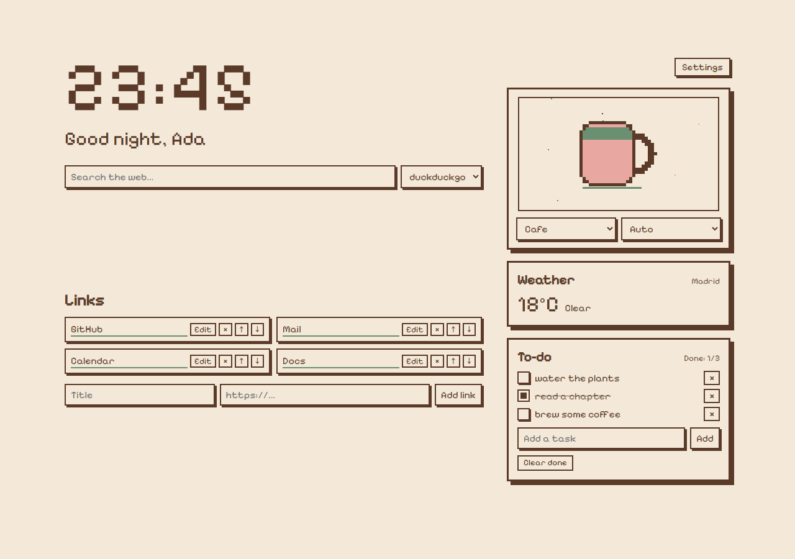
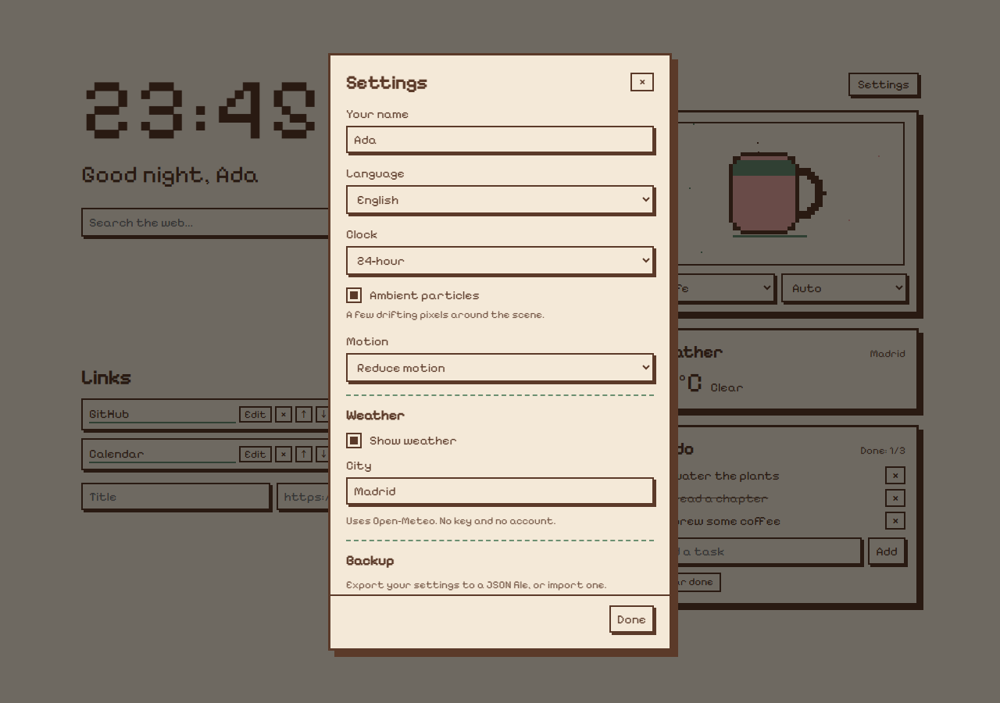
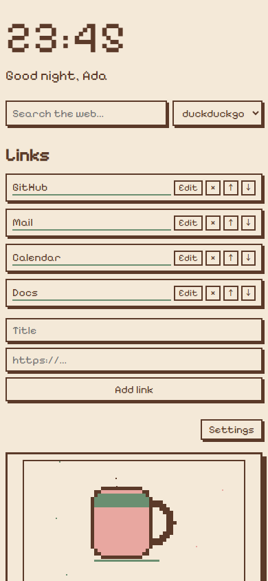

# cozy-startpage

A cozy pixel-art start page for your browser: a big clock, a search box, your links, a small
animated scene, the weather and a to-do list. No account, no backend, no analytics.

**[Open the live demo →](https://mpinedaj.github.io/cozy-startpage/)**



## What it does

- **Clock and greeting** that follow the time of day, with 12h or 24h format and an optional name.
- **Search** with DuckDuckGo, Google, Bing or Brave, without leaving the keyboard.
- **Links** with add, edit, delete and reorder. URLs are limited to `http` and `https`.
- **Pixel scene** drawn on a 320×180 canvas from character matrices: mug, tree, candle or moon. It
  follows the theme and the time of day, and it can run with ambient dust or stay perfectly still.
- **Four themes** built from the same four colors, so everything (UI and canvas) stays coherent.
- **Weather** from Open-Meteo: current temperature and conditions for the city you choose. Opt-in,
  no API key, no account.
- **To-do list** for the day: add, tick, delete, clear the finished ones.
- **Settings** in a native dialog: name, English/Spanish, clock format, ambient particles and motion.
  Changes apply instantly and persist.
- **Backup**: export your whole setup to a JSON file and import it back on any device.

## Use it

The simplest option is the hosted build:
**[https://mpinedaj.github.io/cozy-startpage/](https://mpinedaj.github.io/cozy-startpage/)**

- Set it as your browser's **homepage**, or as the page your browser opens on startup.
- For **new tabs**, Chrome and Chromium need an extension such as _New Tab Redirect_; Firefox can use
  _New Tab Override_. Point them at the URL above.

Everything is stored locally, so a shared computer will not see your links or tasks.

## Privacy

- No analytics, no cookies, no accounts, no server of its own.
- All configuration lives in one versioned `localStorage` key: `cozy-startpage:config`.
- Weather is **off by default**. When you enable it, the page asks Open-Meteo for the city you typed
  (geocoding plus current conditions); those two requests are the only third-party traffic.
- The Content Security Policy only allows scripts, styles and fonts from the origin, plus those two
  Open-Meteo hosts.

## Run it locally

```bash
npm install
npm run dev
```

Requires Node 20 or newer.

## Make it yours

| What                   | Where                                                              |
| ---------------------- | ------------------------------------------------------------------ |
| Colors and themes      | `src/styles/themes.css` — one block per `data-theme`               |
| Scenes                 | `src/scene/scenes/` — one file per motif, registered in `index.ts` |
| Text and languages     | `src/i18n/messages.ts`                                             |
| Search engines         | `src/features/search/engines.ts`                                   |
| Defaults for new users | `src/core/defaults.ts`                                             |

Adding a theme means adding a block with the four palette variables (`cream`, `coffee`, `moss`,
`rose`); the UI and the canvas both read from it.

## Development

Built with Vite, TypeScript (strict) and plain CSS. No UI framework, no runtime dependencies beyond
the self-hosted font.

```bash
npm run dev          # dev server
npm run typecheck    # tsc --noEmit
npm run lint         # eslint
npm run test         # vitest (unit)
npm run e2e          # playwright (needs browsers installed once)
npm run build        # typecheck + production build
npm run format       # prettier
```

CI runs `typecheck`, `lint`, unit tests, `build` and the Playwright suite, and every push to `main`
deploys `dist` to GitHub Pages.

```
src/core        config, storage, migrations, validation, import/export
src/features    clock, search, links, tasks, weather, motion
src/scene       engine, palette, character-matrix scenes
src/ui          task and weather widgets
src/i18n        English and Spanish strings
src/styles      base layout and themes
e2e             Playwright specs against the production build
docs            plan, progress log and architecture decisions
```

## Screenshots

| Settings                                          | Phone                                        |
| ------------------------------------------------- | -------------------------------------------- |
|  |  |

## License

MIT — see [LICENSE](LICENSE).
